> Wallpapers created by me using [SlackWall](https://forge.slackware.nl/rizitis/SlackWall) scripts 

# plasma-wallpapers

KDE Plasma wallpapers rendered with [SlackWall](https://forge.slackware.nl/rizitis/SlackWall).

Every folder is a complete Plasma wallpaper package with light and dark
variants in resolutions from 1920x540 up to 7680x5760.

**This repository is very large (several GB). Do not `git clone` it
normally.** Pick the wallpapers you want from the previews below and
download only those, as shown next.

## Download only the wallpapers you want

Requires git 2.27 or newer.

**1. Clone the repository without the wallpapers** (a few hundred KB):

```bash
git clone --depth 1 --filter=blob:none --sparse https://github.com/rizitis/plasma-wallpapers.git
cd plasma-wallpapers
```

**2. Choose the folders.** Use the folder names from the previews below:

```bash
git sparse-checkout set slackwall-blobs-326362582 slackwall-knots-1575146810
```

Only those folders are downloaded. Each one is roughly 150-600 MB.

To list all available folders from inside the clone:

```bash
git ls-tree -d --name-only HEAD
```

**Add more later** (keeps the ones you already have):

```bash
git sparse-checkout add slackwall-cloud-759497691
```

**Replace your selection** (folders not listed are removed from disk):

```bash
git sparse-checkout set slackwall-silk-749016951
```

**Get new wallpapers or updates** for your selection:

```bash
git pull
```

## Install in Plasma

Copy the folders into your local wallpapers directory:

```bash
mkdir -p ~/.local/share/wallpapers
cp -r slackwall-*/ ~/.local/share/wallpapers/
```

For all users, copy them to `/usr/share/wallpapers/` as root instead.

Then right click the desktop, choose **Configure Desktop and Wallpaper**,
and the new wallpapers appear in the list. Plasma picks the resolution
that matches your screen and switches to the dark variant when you use a
dark color scheme.

## Folder layout

```
slackwall-NAME-SEED/
├── metadata.json
└── contents/
    ├── screenshot.png
    ├── images/          light variant, all resolutions
    └── images_dark/     dark variant, all resolutions
```

## Previews

|   |   |   |
|---|---|---|
| 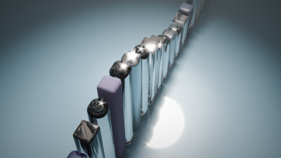<br>`slackwall-bars-1328263361` | 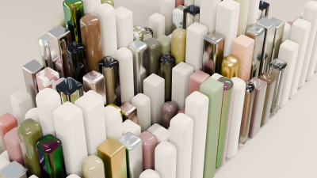<br>`slackwall-bars-1941110598` | <br>`slackwall-bars-55350366` |
| 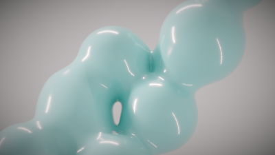<br>`slackwall-blobs-2071179465` | 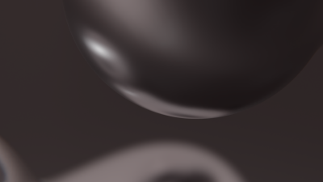<br>`slackwall-blobs-326362582` | 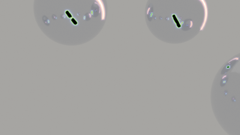<br>`slackwall-blobs-375992608` |
| 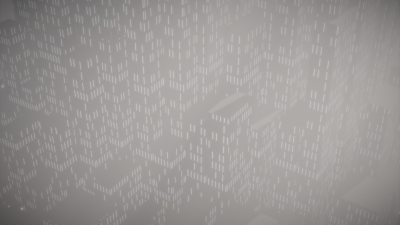<br>`slackwall-city-bluehour-aerial-1503273170` | 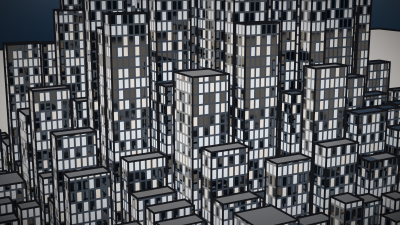<br>`slackwall-city-bluehour-aerial-2104434592` | 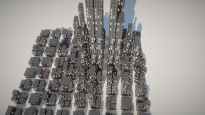<br>`slackwall-city-bluehour-aerial-880131034` |
| 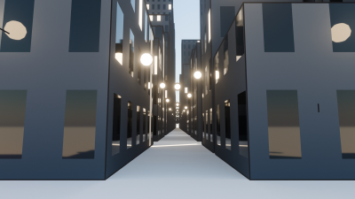<br>`slackwall-city-bluehour-street-1834424028` | 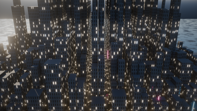<br>`slackwall-city-night-aerial-1465435221` | 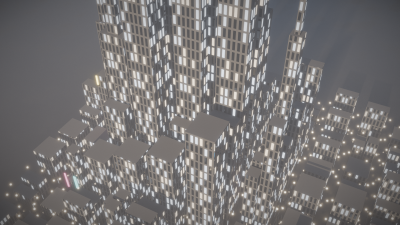<br>`slackwall-city-night-aerial-544553971` |
| 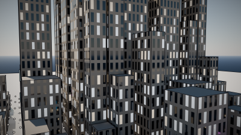<br>`slackwall-city-night-rooftop-239635260` | 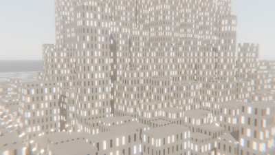<br>`slackwall-city-night-rooftop-249009477` | 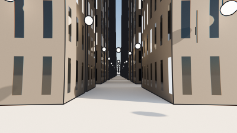<br>`slackwall-city-night-street-950860459` |
| 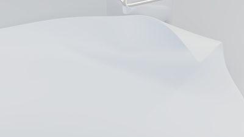<br>`slackwall-cloth-150100151` | 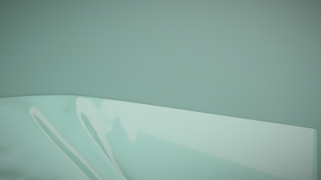<br>`slackwall-cloth-2020515205` | 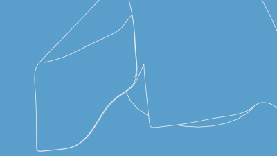<br>`slackwall-cloth-516163281` |
| 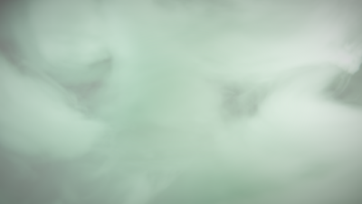<br>`slackwall-cloud-1300702656` | 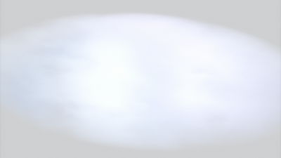<br>`slackwall-cloud-144738658` | 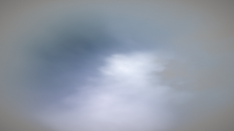<br>`slackwall-cloud-759497691` |
| 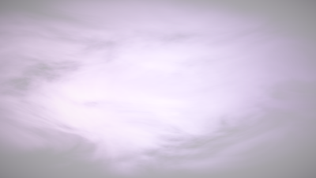<br>`slackwall-cloud-793342207` | 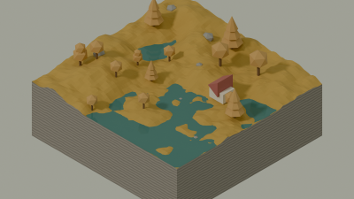<br>`slackwall-diorama-autumn-1670216078` | 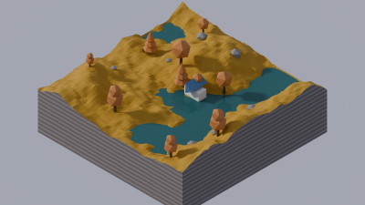<br>`slackwall-diorama-autumn-2108737612` |
| 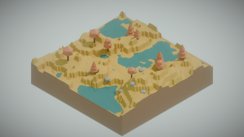<br>`slackwall-diorama-autumn-499331415` | 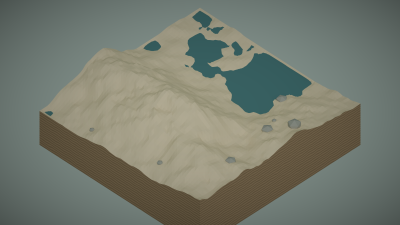<br>`slackwall-diorama-desert-1109794997` | 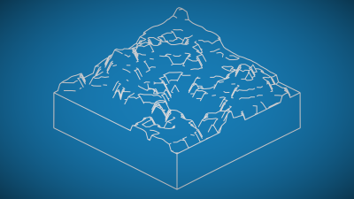<br>`slackwall-diorama-desert-650865503` |
| 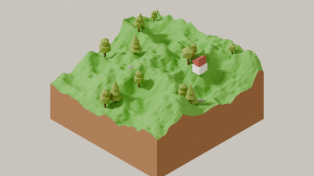<br>`slackwall-diorama-meadow-1631760197` | 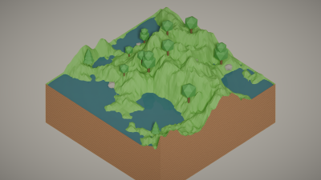<br>`slackwall-diorama-meadow-1948352396` | 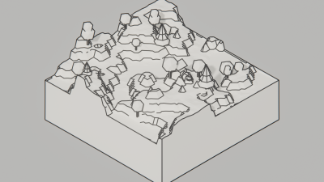<br>`slackwall-diorama-meadow-637741245` |
| 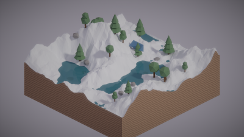<br>`slackwall-diorama-snow-1724221336` | 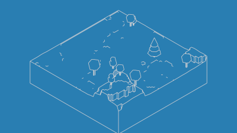<br>`slackwall-diorama-snow-1931466788` | 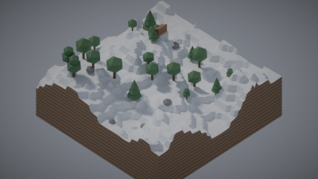<br>`slackwall-diorama-snow-2145355683` |
| 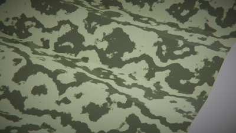<br>`slackwall-folds-1295749600` | <br>`slackwall-folds-1337768984` | 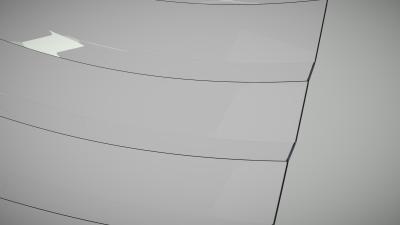<br>`slackwall-folds-191567412` |
| 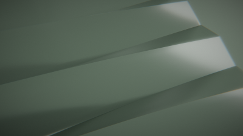<br>`slackwall-folds-2061081494` | 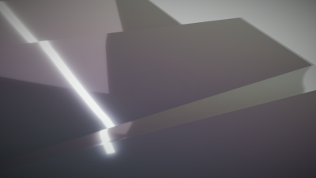<br>`slackwall-folds-503684299` | 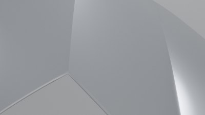<br>`slackwall-folds-541836218` |
| 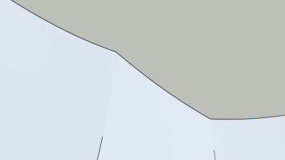<br>`slackwall-folds-711711527` | 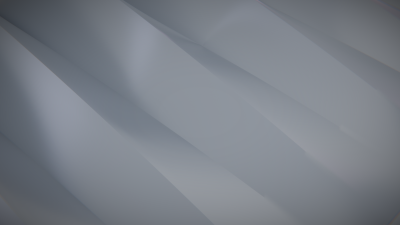<br>`slackwall-folds-917196518` | 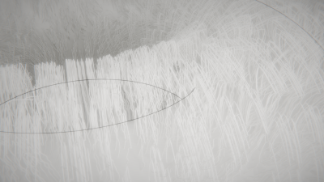<br>`slackwall-fur-141601962` |
| 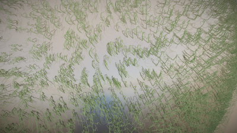<br>`slackwall-fur-470877854` | 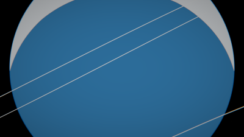<br>`slackwall-glass-1785354949` | 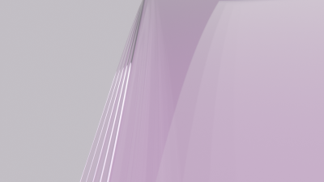<br>`slackwall-glass-1831693611` |
| 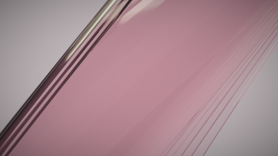<br>`slackwall-glass-2040962207` | 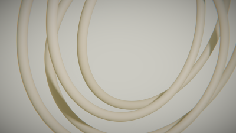<br>`slackwall-knots-1255580737` | 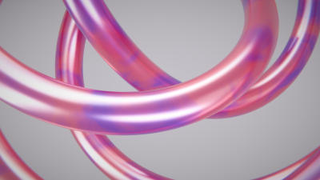<br>`slackwall-knots-1575146810` |
| 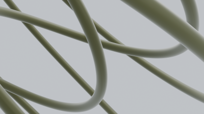<br>`slackwall-knots-1899852606` | 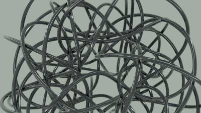<br>`slackwall-knots-2144309106` | 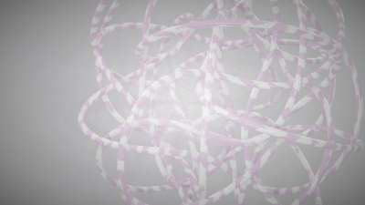<br>`slackwall-knots-327518546` |
| 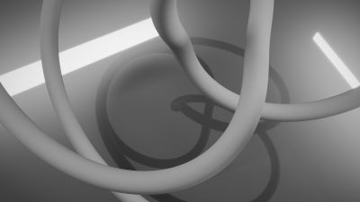<br>`slackwall-knots-498237864` | <br>`slackwall-knots-625025072` | <br>`slackwall-landscape-alien-2015495370` |
| <br>`slackwall-landscape-alpine-1451720918` | <br>`slackwall-landscape-arctic-386126082` | <br>`slackwall-landscape-canyon-1024747435` |
| <br>`slackwall-landscape-canyon-158077563` | <br>`slackwall-landscape-desert-1292392465` | <br>`slackwall-landscape-islands-774521012` |
| <br>`slackwall-ocean-day-1296037718` | <br>`slackwall-ocean-day-291314497` | <br>`slackwall-ocean-golden-1736817860` |
| <br>`slackwall-ocean-golden-1800841932` | <br>`slackwall-ocean-golden-527155169` | <br>`slackwall-ocean-golden-849890977` |
| <br>`slackwall-ocean-night-222448015` | <br>`slackwall-ocean-sunset-1400450760` | <br>`slackwall-ocean-sunset-1821608104` |
| <br>`slackwall-ocean-sunset-962514165` | <br>`slackwall-pile-1971214629` | <br>`slackwall-pile-543774152` |
| <br>`slackwall-pile-698171483` | <br>`slackwall-plates-1286429672` | <br>`slackwall-plates-1442104211` |
| <br>`slackwall-plates-685793698` | <br>`slackwall-plates-998547740` | <br>`slackwall-prisms-1308219530` |
| <br>`slackwall-prisms-1696990064` | <br>`slackwall-prisms-1729808467` | <br>`slackwall-prisms-658826976` |
| <br>`slackwall-ribbons-1403514397` | <br>`slackwall-ribbons-1891368685` | <br>`slackwall-ribbons-441723503` |
| <br>`slackwall-rings-1086857703` | <br>`slackwall-rings-1751827165` | <br>`slackwall-rings-470076065` |
| <br>`slackwall-rings-902389106` | <br>`slackwall-scatter-1259078177` | <br>`slackwall-scatter-1548081209` |
| <br>`slackwall-scatter-2115446257` | <br>`slackwall-scatter-2136579057` | <br>`slackwall-scatter-224434988` |
| <br>`slackwall-scatter-979064197` | <br>`slackwall-scatter-984937884` | <br>`slackwall-silk-1575308752` |
| <br>`slackwall-silk-1851204939` | <br>`slackwall-silk-341171597` | <br>`slackwall-silk-749016951` |
| <br>`slackwall-space-earth-1493208896` | <br>`slackwall-space-earth-1789476583` | <br>`slackwall-space-earth-1934364184` |
| <br>`slackwall-space-gas-1069116696` | <br>`slackwall-space-gas-1944365870` | <br>`slackwall-space-gas-913263696` |
| <br>`slackwall-space-ice-1318842962` | <br>`slackwall-space-lava-2120014179` | <br>`slackwall-space-lava-503695277` |
| <br>`slackwall-space-lava-77503206` | <br>`slackwall-spheres-1545635549` | <br>`slackwall-spheres-1554808829` |
| <br>`slackwall-spheres-227407839` | <br>`slackwall-spheres-302716582` | <br>`slackwall-spheres-839810660` |
| <br>`slackwall-synthwave-1226332596` | <br>`slackwall-synthwave-1254823173` | <br>`slackwall-synthwave-1549782459` |
| <br>`slackwall-synthwave-1713453224` | <br>`slackwall-synthwave-2121341325` | <br>`slackwall-synthwave-486001889` |
| <br>`slackwall-synthwave-516511828` | <br>`slackwall-synthwave-542369145` | <br>`slackwall-synthwave-558268078` |
| <br>`slackwall-synthwave-974797688` | <br>`slackwall-tubes-1406522509` | <br>`slackwall-tubes-416289307` |
| <br>`slackwall-tubes-558993130` | <br>`slackwall-tubes-879910681` | <br>`slackwall-voxel-1431105069` |
| <br>`slackwall-voxel-1473921262` | <br>`slackwall-voxel-1601855505` | <br>`slackwall-voxel-1608928566` |
| <br>`slackwall-voxel-1967477878` | <br>`slackwall-voxel-2071423218` | <br>`slackwall-voxel-2136802400` |
| <br>`slackwall-voxel-53313646` | <br>`slackwall-voxel-621340978` | <br>`slackwall-voxel-758680489` |

## License

See [LICENSE](LICENSE).

